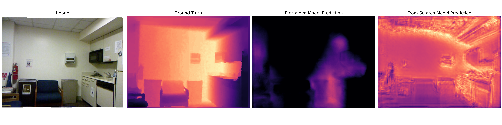
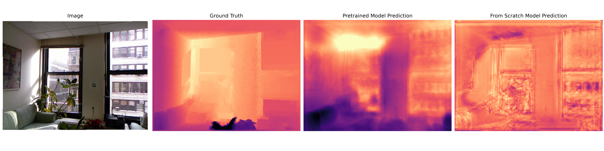
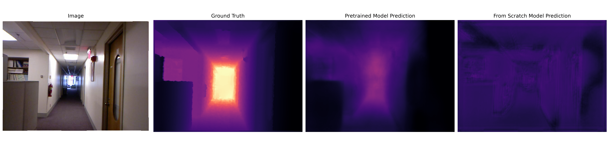
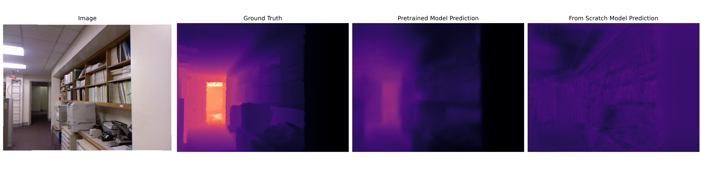
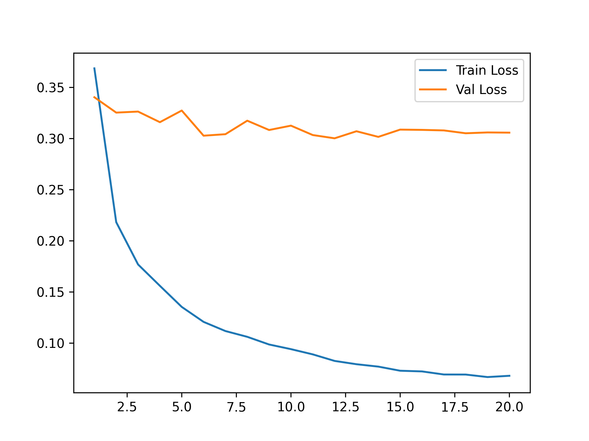
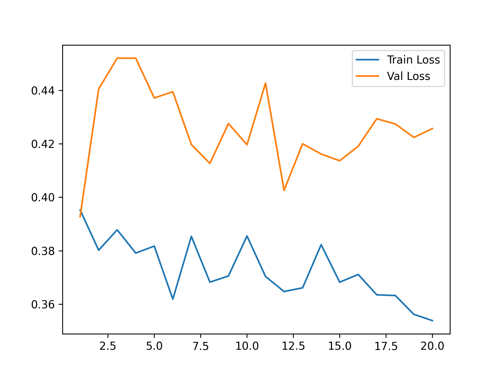

# ConvNeXt-Tiny U-Net for Monocular Depth Estimation (JAX / Flax NNX)

A clean from-scratch implementation of a **ConvNeXt-Tiny U-Net** for monocular depth estimation in **JAX** and **Flax NNX**, trained and evaluated on **NYU Depth v2**. Includes manual PyTorch (`timm`) → Flax NNX weight porting with controlled initialization ablation comparing ImageNet-pretrained vs. from-scratch training.

## Highlights

- **Custom Flax NNX Architecture (`model.py`):** ConvNeXt-Tiny encoder (`depths=[3, 3, 9, 3]`, `channels=[96, 192, 384, 768]`) with `7×7` depthwise convolutions, LayerScale (`gamma`), and exact GELU (`approximate=False`), paired with a 3-stage bilinear U-Net decoder and positive depth head (`softplus + 1e-5`).
- **PyTorch (`timm`) → Flax NNX Weight Porting (`utils.py`):** Manually maps `timm` `convnext_tiny` weights (handling `OIHW → HWIO` conv transposes, `2D linear → 1×1 conv` reshaping, and LayerScale parameters).
- **Controlled Initialization Ablation:** Trained both ImageNet-pretrained and randomly initialized models under the exact same setup (20 epochs, AdamW, `1e-4` peak LR with 2-epoch linear warmup + cosine decay, SI-Log loss with `λ = 0.85`).

## Validation Results (NYU Depth v2)

Evaluated across the full validation split of [`sayakpaul/nyu_depth_v2`](https://huggingface.co/datasets/sayakpaul/nyu_depth_v2) (`revision="refs/convert/parquet"`), masking invalid pixels (`depth <= 1e-3` or non-finite):

| Metric | ImageNet-Pretrained | From Scratch |
| :--- | :---: | :---: |
| **SI-Log** (↓) | **0.2807** | 0.3667 |
| **AbsRel** (↓) | **0.2986** | 0.4124 |
| **RMSE** (↓) | **1.1153** | 1.1866 |
| **δ < 1.25** (↑) | 0.3393 | **0.3929** |
| **δ < 1.25²** (↑) | 0.6605 | **0.6757** |
| **δ < 1.25³** (↑) | **0.8711** | 0.8476 |

*Note:* The pretrained model substantially outperforms the from-scratch baseline on SI-Log, AbsRel, RMSE, and qualitative scene geometry. Because SI-Log (`λ = 0.85`) is scale-invariant, it prioritizes relative depth structure over global metric scale, which explains why unaligned `δ < 1.25` is slightly lower despite much sharper, more coherent depth maps.

## Qualitative Comparison

*Columns (left to right): Input RGB, Ground Truth, ImageNet-Pretrained Prediction, From-Scratch Prediction (shared per-row depth scale).*






## Training Curves

| ImageNet-Pretrained | From Scratch |
| :---: | :---: |
|  |  |

## Repository Structure

```text
.
├── model.py           # ConvNeXt-Tiny encoder + U-Net decoder in Flax NNX
├── data.py            # Streaming NYU Depth v2 loader + Albumentations pipelines
├── utils.py           # Orbax checkpoint loading, JIT forward pass, timm weight porting
├── train.py           # Training loop (SI-Log loss, AdamW + warmup cosine schedule)
├── eval.py            # Full validation evaluation (SI-Log, AbsRel, RMSE, δ thresholds)
├── visualize.py       # Side-by-side depth comparison plotter
├── requirements.txt   # Core Python dependencies
└── assets/            # Training curves and qualitative comparison figures
```

## Setup

```bash
pip install -r requirements.txt
```

For NVIDIA GPU acceleration on Linux, install the CUDA-enabled JAX wheel instead of plain `jax`:

```bash
pip install -U "jax[cuda12]"
```

## Usage

### Train

```bash
# Fine-tune from ImageNet-pretrained ConvNeXt-Tiny encoder
python train.py --pretrained --epochs 20 --batch-size 16 --lr 1e-4 --ckpt-dir checkpoints/best

# Train from scratch (controlled ablation)
python train.py --epochs 20 --batch-size 16 --lr 1e-4 --ckpt-dir checkpoints/best_scratch
```

### Evaluate

```bash
python eval.py --ckpt checkpoints/best --batch-size 8 --output best_metrics
python eval.py --ckpt checkpoints/best_scratch --batch-size 8 --output best_scratch_metrics
```

### Visualize

```bash
python visualize.py \
  --pretrained-ckpt checkpoints/best \
  --scratch-ckpt checkpoints/best_scratch \
  --num-samples 4 \
  --output assets
```